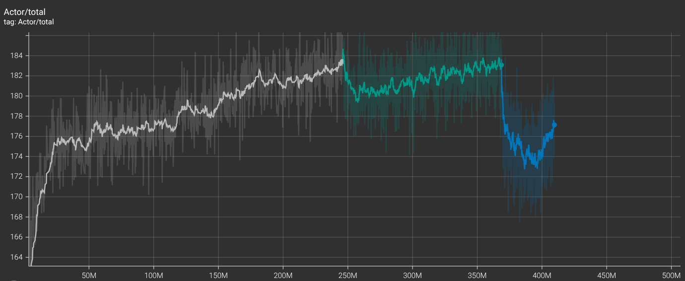
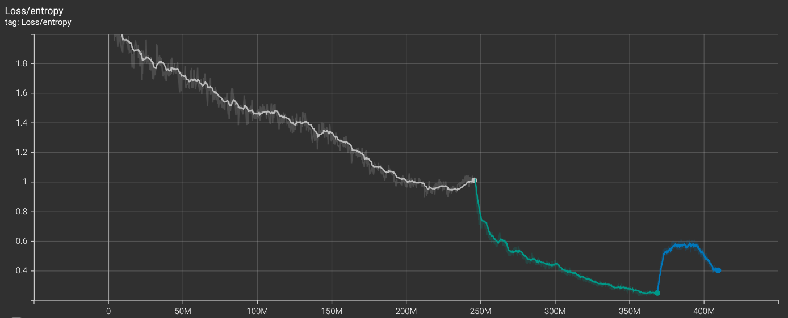
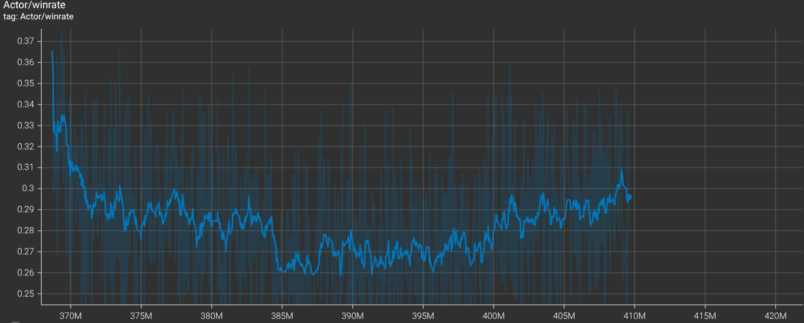

# yams-rl

A Yams (French Yahtzee) agent trained with **PPO implemented from scratch** in PyTorch, with no dynamic-programming solver and no imitation learning.

## Results

Evaluated over 10,000 games (95% CI = 1.96 × σ/√N).

| Player | Mean score |
|---|---|
| Random | 26.7 ± 0.2 |
| **PPO agent** (368M steps) | **183.7 ± 0.6** |
| Greedy baseline (one-step expectation, N=5,000) | 210.3 ± 0.9 |

3-player games, random seat order:

| Table | Win rate |
|---|---|
| Greedy / PPO / Random | 72.7% / 27.3% / 0.0% |
| PPO / PPO / PPO (sanity check) | 33.6% / 32.9% / 33.5% |

The PPO agent does not yet beat the greedy baseline. Extrapolating the learning curve, closing the gap would need roughly 30× more environment steps. That is a motivation for a faster environment so more compute can be used.



Training score (moving average). Grey: solo pretraining. Teal: resumed run from the checkpoint. Blue: multiplayer fine-tuning on win/loss reward, where the score drops.

## Game rules

5 dice, up to 3 rolls per turn, one category filled per turn.

## Environment

- **Observation**: rolls left, dice (sorted), the score each category would give with the current dice, own grid and filled mask, then for a fixed number of opponent slots a "present" flag, grid and filled mask.
- **Actions**: 32 keep-masks (which dice to reroll) plus one action per category. Illegal actions are masked by setting their logits to the minimum float value.
- **Rewards**: score delta per step, normalized (solo), or 1 / 0.5 / 0 for win / tie / loss at the end of the game (multiplayer).
- **Opponents**: frozen players live inside the environment, so PPO only sees the agent's own turns.

Sorting the dice gave about **+40 points**. Feeding the per-category possible scores did not raise the final score, but sped up learning.

## PPO

Single-file style, close to [CleanRL](https://docs.cleanrl.dev/):

- GAE from [this](https://arxiv.org/pdf/1506.02438) (γ = 1, λ = 0.98), advantage normalization, clipped objective (ε = 0.2), gradient clipping (0.5)
- 16 environments × 512 steps per rollout, 4 minibatches, 8 epochs
- AdamW (no weight decay), linear decay of the learning rate and of the entropy coefficient
- checkpoints holding model, optimizer state and step counter, so a run can resume
- TensorBoard logging: losses, approx-KL, clip fraction, entropy, score, win rate

## Evaluation

- Games run in parallel with joblib, each with its own `SeedSequence`: separate streams for the dice, each player and PyTorch.
- Seats are optionally shuffled per game, and results are mapped back to each original player.
- Sanity checks run before trusting any number: identical players must each win about 1/N of the games, and a random player must never win against stronger ones.

## Multiplayer fine-tuning: a negative result

Fine-tuning the solo agent on the win/loss reward, against two frozen copies of itself, **made it weaker**: its training-time win rate went from about 33% to about 27%, then recovered to about 30%.




Diagnosis: with about 230 games per batch, the per-batch win rate has a standard error of about 3 points, so the normalized advantages are mostly noise. The policy gradient random-walks while the entropy bonus pushes consistently in one direction: entropy doubled (0.27 → 0.57), with approx-KL around 0.04. Recovery starts exactly when the learning rate starts decaying. Likely fixes: no entropy bonus, fewer epochs, larger rollouts and a smaller learning rate.

## Usage

Requires [uv](https://docs.astral.sh/uv/) and Python 3.13.

```bash
# Train a solo agent
uv run -m src.yams_rl.rl.training --num-ppo-iter 20_000

# Evaluate (one player = mean score; several = win rates)
uv run -m src.yams_rl.benchmark.evaluate --players GreedyPlayer Agent --model-path models/agent.pt --shuffle-seat

# Fine-tune against two frozen copies
uv run -m src.yams_rl.rl.training --opponents Agent Agent \
  --checkpoint-path models/agent.pt --opponents-path models/agent.pt models/agent.pt

# Play in the terminal
# If you want to play against the agent
uv run -m src.yams_rl.app.terminal --players Martin Clarisse --player-type Agent --model_path "models/agent_solo.pt"
# or against the GreedyPlayer
uv run -m src.yams_rl.app.terminal --players Martin Clarisse --player-type GreedyPlayer

```

All options: `--help` (CLI built with [tyro](https://brentyi.github.io/tyro/)).

## Project structure

```
src/yams_rl/
├── yams/        # game logic: dice, scoring, GameState, players (random, greedy, human), engine
├── rl/          # env, observation encoding, vectorized env, model, PPO, training, config
├── benchmark/   # parallel evaluation
└── app/         # terminal interface
```

## Future work

- Vectorized environment (JAX or Rust/PyO3): the Python env is the main bottleneck
- An exact Dynamic Programming solver for the gap to optimal play

## A few issues encountered

- **Aliasing**: the vectorized env returned views of its internal buffers, so stored observations changed after the fact. An assertion that the PPO ratio equals 1 on the first minibatch caught it.
- **Shapes**: a `(N, 1)` value tensor broadcast against `(N,)` returns silently corrupted the critic loss.
- **RL representation**: Changing representation like always sorting the dices before giving them to the model improved a lot the scores 

## References

- Schulman et al., [Proximal Policy Optimization Algorithms](https://arxiv.org/abs/1707.06347), 2017
- Huang et al., [The 37 Implementation Details of PPO](https://iclr-blog-track.github.io/2022/03/25/ppo-implementation-details/), 2022
- Andrychowicz et al., [What Matters in On-Policy Reinforcement Learning?](https://arxiv.org/abs/2006.05990), 2021
- [CleanRL](https://docs.cleanrl.dev/)
- Schulman et al., [HIGH-DIMENSIONAL CONTINUOUS CONTROL USING
GENERALIZED ADVANTAGE ESTIMATION](https://arxiv.org/pdf/1506.02438), 2016
